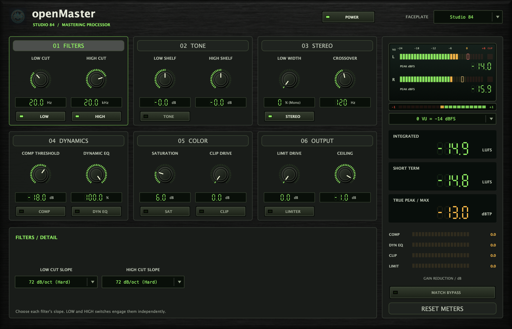

# openMaster


> **Built with one prompt with Gemini 3.8 Flash:**
> *"let's create a VST plugin. a mastering plugin that has three capabilities: eq high cut, eq low cut, and low-end stereo field -- the stereo field should go from mono to stereo enhance on a dial and should have a knob selector for the frequency where the stereo field kicks in. for the lown-end stereo, it should basically only work with frequences below the knob selector and apply the stereo widening or narrowing to everything below that selected frequency. it's a simple interface, inspired by classic analog gear. generate graphics for the package as needed. create a new repo in github.com/alanmarcero, make it public. give it build pipelines similar to the winamp plugin i also have in github.com/alanmarcero for the low cut and high cut eq, it has a HARD slope cutoff for low end and highend. like -64db hard, as hard as you can really. but the slope it can also be configurable. the idea is we cut everything above 20khz and below 20hz but that should be loosely configurable with a dial or switch. make sure the ui is uniform and models classic analog gear.*
> 
> *dont ask questions. don't clarify. don't stop. do not pass go, just build it and deploy it."*

---

**openMaster** is a VST3 mastering processor with filtering, tone EQ, stereo shaping, compression, dynamic EQ, saturation, clipping, limiting, and loudness metering.
---

## 1980s Studio Rack Interface

The entire editor follows the stereo LED meters: a generated charcoal aluminum faceplate, smoked display windows, green seven-segment value readouts, segmented knob scales, dark fluted knobs, and rectangular switches with green or amber status lamps. The numeric fields remain editable. Labels, controls, and meters render live; the background is embedded in the plugin.



The **THEME** selector offers five illumination palettes over the same rack hardware:

| Theme | Display / status colors |
| --- | --- |
| Studio 84 (default) | Green / amber |
| Silver | Soft white / amber |
| Phosphor | Green / pale lime |
| Ice | Ice blue / amber |
| Amber | Amber / warm red |

Meter level colors remain green, amber, and red in every theme. Theme indices are unchanged, so existing sessions retain their selected slot. The [artwork prompt](assets/ANALOG-CYBER.md) documents the generated faceplate.

---

## Mastering chain

The six cards expose the everyday controls. Click a card heading for its detailed
settings. Dynamics and Color each have a selector in the detail strip. Dynamic EQ
has a band selector, so all three bands share the same controls.

| Section | Main controls | Detail controls |
| --- | --- | --- |
| Filters | Low cut, high cut; individual switches | 12–96 dB/oct slopes |
| Tone | Low and high shelf gain | Tilt, shelf frequencies |
| Stereo | Low-band width, crossover | Low-band audition |
| Dynamics | Compressor threshold, dynamic EQ amount | Ratio, attack, release, knee, mix, makeup, detector HP; three EQ bands with frequency, Q, threshold, max cut, timing and audition |
| Color | Saturation drive, clipper drive | Tape/Transformer curves, mix, output and gain compensation; soft/hard clip, ceiling and mix |
| Output | Limiter drive, ceiling | Release and pre-limit master trim |

Signal order: low cut → low-band stereo → high cut → tone → compressor →
dynamic EQ → saturation → master trim → clipper → limiter.

New stages default **off**. Existing parameter IDs, order, ranges and defaults
remain intact. Old sessions retain their filtering/stereo settings and leave new
stages off. Oversampling and lookahead add a fixed latency, reported to the host;
stage switches and global/host bypass preserve that latency.

Saturation and clipping use fixed 8× oversampling. The limiter uses stereo-linked
lookahead and reconstructed-peak detection. The saturation character names describe
waveshaping flavors, not physical emulations of a particular tape machine or transformer.

## Meters and comparison

- Stereo 30-segment VU bars, held sample peaks in dBFS, clip lamps, phase correlation.
- Integrated and 3-second short-term LUFS; held reconstructed true peak in dBTP.
- Separate compressor, dynamic EQ, clipper and limiter gain-reduction displays.
- **RESET METERS** starts a new loudness/peak measurement without clearing the audio chain.
- **MATCH BYPASS** measures aligned wet/dry short-term loudness. After 3 seconds,
  it smoothly attenuates the louder branch, up to 12 dB. Use **POWER** to compare.
  Matching affects audible output and therefore exports; turn it off for final delivery.
  During silence, the last valid comparison is held. This is an audition aid, not
  automatic target-LUFS mastering.

VU uses sine-RMS calibration and a 99%-in-300-ms response. Its reference defaults to
−14 dBFS and can be set from −8 to −20 dBFS. Loudness measures actual output,
including bypass and comparison trim. Integrated loudness uses BS.1770 weighting
and gates with a bounded 0.001 LU histogram; boundary gating is approximate.

Algorithm sources, timing, and limitations: [DSP research notes](docs/MASTERING_DSP.md)
and [stage implementation notes](docs/MASTERING_STAGES.md). These tests are engineering
validation, not a claim of broadcast-meter certification.

---

## Architecture & Code Structure

```
openMaster/
├── .github/
│   └── workflows/
│       └── build.yml             # macOS Universal + Windows CI, pluginval, artifact packaging
├── assets/
│   ├── banner.jpg                # Photorealistic 16:9 hero banner
│   ├── icon.jpg                  # High-resolution plugin icon
│   ├── analog-cyber-faceplate.png # Embedded charcoal rack texture
│   ├── analog-cyber-preview.png  # Native Studio 84 editor capture
│   └── ANALOG-CYBER.md           # Image-generation prompt
├── Source/
│   ├── Core/                     # Pure C++20 DSP engine (zero GUI dependencies)
│   │   ├── BiquadFilter.h/.cpp
│   │   ├── ButterworthCoeffs.h/.cpp
│   │   ├── MultiPoleFilter.h/.cpp
│   │   ├── LinkwitzRiley.h/.cpp
│   │   ├── StereoFieldShaper.h/.cpp
│   │   └── MasterProcessorCore.h/.cpp
│   └── Plugin/                   # JUCE 8 VST3 Plugin implementation
│       ├── Parameters.h/.cpp     # APVTS parameter layout
│       ├── AnalogLookAndFeel.h/.cpp # Custom vintage analog LookAndFeel
│       ├── VintageMeter.h/.cpp   # Segmented stereo LED meters and digital peak readouts
│       ├── PluginProcessor.h/.cpp# JUCE AudioProcessor
│       └── PluginEditor.h/.cpp   # JUCE AudioProcessorEditor
├── Tests/                        # Catch2 unit test suite
│   ├── BiquadFilterTests.cpp
│   ├── ButterworthCoeffsTests.cpp
│   ├── StereoFieldShaperTests.cpp
│   └── MasterProcessorCoreTests.cpp
├── CMakeLists.txt
├── LICENSE
└── README.md
```

---

## Building Locally

### Prerequisites
- CMake 3.22 or newer
- C++20 compatible compiler (Clang 14+, GCC 12+, MSVC 2022+)

### Build & Run Tests
```bash
cmake -B build -DCMAKE_BUILD_TYPE=Release
cmake --build build --config Release --parallel
ctest --test-dir build --output-on-failure
```

Optional native editor/state checks (requires a desktop session):
```bash
cmake -S . -B build -DAMS_BUILD_HOST_CHECKS=ON
cmake --build build --config Release --parallel
ctest --test-dir build -C Release --output-on-failure
# On a single-configuration build, optionally capture all detail views and themes:
./build/open_master_host_checks /tmp/openmaster-previews
```


---

## Continuous Integration & Release Pipelines

Automated multi-platform CI pipelines run on every commit and pull request:
- **macOS (`macos-14`):** Universal binary (`arm64` Apple Silicon + `x86_64` Intel), ad-hoc codesigning, automated unit tests, and validation via `pluginval` at strictness level 5.
- **Windows (`windows-latest`):** Native MSVC build, automated unit tests, validation via `pluginval`, and zipped distribution packages.

---

## License

MIT License. Copyright (c) 2026 Alan Marcero.
