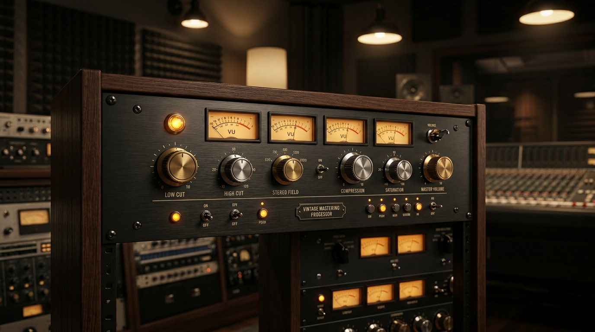
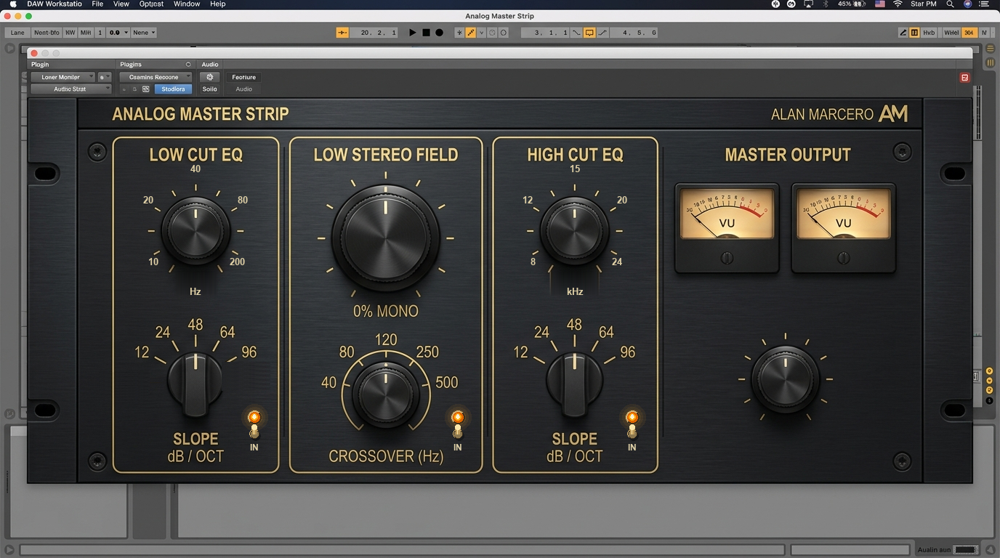
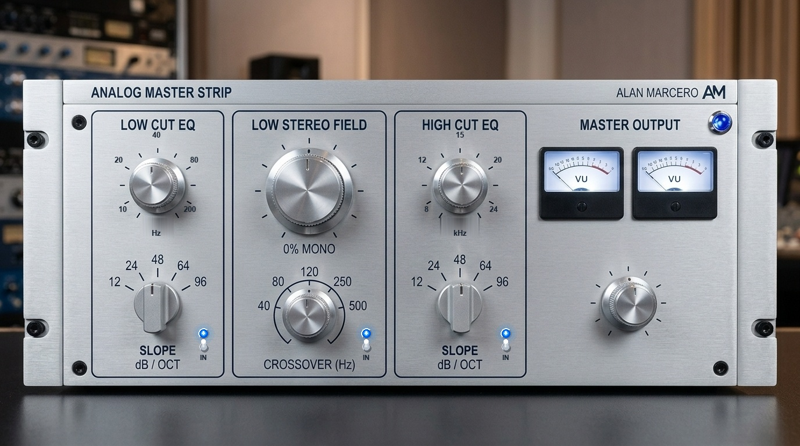
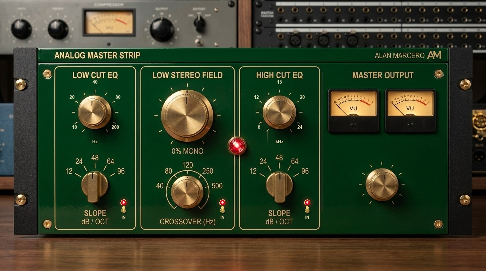
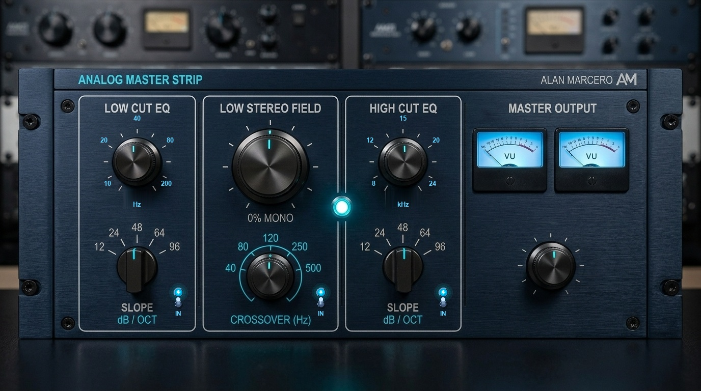
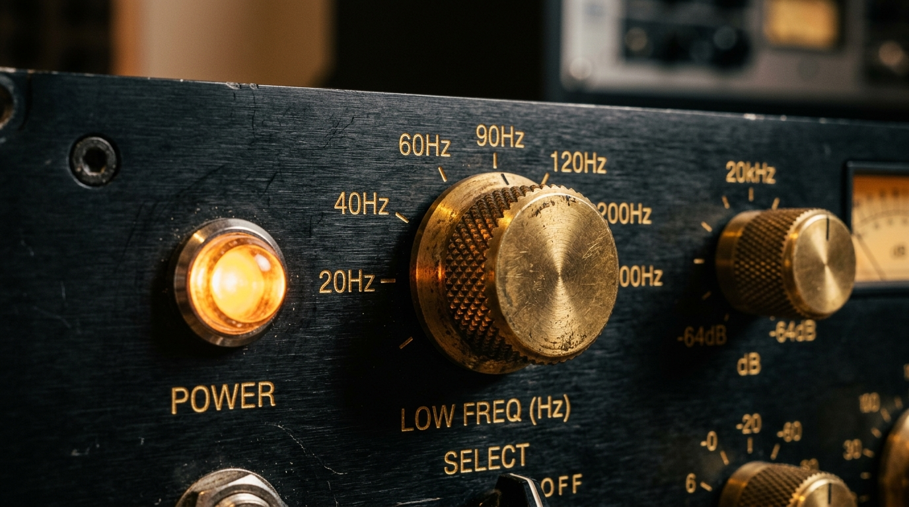

# Analog Master Strip



> **Built with one prompt with Gemini 3.8 Flash:**
> *"let's create a VST plugin. a mastering plugin that has three capabilities: eq high cut, eq low cut, and low-end stereo field -- the stereo field should go from mono to stereo enhance on a dial and should have a knob selector for the frequency where the stereo field kicks in. for the lown-end stereo, it should basically only work with frequences below the knob selector and apply the stereo widening or narrowing to everything below that selected frequency. it's a simple interface, inspired by classic analog gear. generate graphics for the package as needed. create a new repo in github.com/alanmarcero, make it public. give it build pipelines similar to the winamp plugin i also have in github.com/alanmarcero for the low cut and high cut eq, it has a HARD slope cutoff for low end and highend. like -64db hard, as hard as you can really. but the slope it can also be configurable. the idea is we cut everything above 20khz and below 20hz but that should be loosely configurable with a dial or switch. make sure the ui is uniform and models classic analog gear.*
> 
> *dont ask questions. don't clarify. don't stop. do not pass go, just build it and deploy it."*

---

**Analog Master Strip** is a professional mastering VST3 audio plugin designed for surgical low/high-frequency boundary control and low-end stereo field sculpting, wrapped in a uniform, classic analog rackmount interface.

---

## Screenshots & Faceplate Looks

The interface includes a real-time **LOOK** selector in the top header, allowing instant switching between 4 authentic vintage studio aesthetics:

### 1. Classic Charcoal & Warm Gold (Default)
*Brushed dark charcoal faceplate, spun brass knobs, warm amber jewel lamps, and vintage parchment VU meters.*


### 2. Studio Silverface Edition
*1970s brushed silver aluminum faceplate, dark navy silkscreen, precision fluted silver knobs, electric sapphire-blue jewel lamp, and clean white studio VU meters.*


### 3. British Console Heritage Edition
*Deep British racing green enamel faceplate, antique cream & gold typography, solid brass knurled knobs, glowing ruby-red jewel lamp, and ivory VU meters.*


### 4. Midnight Slate Mastering Edition
*Anodized midnight navy brushed aluminum, laser cyan silkscreen, precision dark gunmetal slate dials, electric cyan pilot lamp, and fluorescent ice-blue backlit VU meters.*


### Analog Hardware Detailing


---

## Capabilities

### 1. Ultra-Steep Low Cut EQ
- **Frequency Dial:** Range from 10 Hz to 200 Hz (nominal 20 Hz default, silk-screened at `10`, `20`, `40`, `80`, `200` Hz).
- **Hard Slope Cutoff:** Configurable slopes:
  - `12 dB/oct` (2-pole Butterworth)
  - `24 dB/oct` (4-pole Butterworth)
  - `48 dB/oct` (8-pole Butterworth)
  - `64 dB/oct` (12-pole cascaded Butterworth — ultra-hard slope)
  - `96 dB/oct` (16-pole cascaded Butterworth — extreme brickwall)
- Eliminates sub-audible DC rumble and frees up precious mastering headroom with zero passband ripple.
- **Dedicated IN Bypass Switch:** Toggle switch with glowing jewel pilot lamp to A/B sub-bass cleanup instantly.

### 2. Low-End Stereo Field Shaper
- **Continuously Variable Stereo Field Dial:**
  - `0%` = **Pure Mono** (completely eliminates out-of-phase low-end rumble for punchy vinyl/club-ready bass).
  - `100%` = **Original Stereo** (transparent pass-through).
  - `200%` = **Stereo Enhance** (widens and blooms the low-end stereo image).
- **Crossover Frequency Selector Knob:** Configurable cutoff (40 Hz to 500 Hz, silk-screened at `40`, `80`, `120`, `250`, `500` Hz). The stereo field processing affects **only** audio frequencies below this selector, leaving everything above the crossover frequency in pristine, untouched stereo.
- **Linkwitz-Riley 4th-Order (LR4) Phase-Matched Crossover:** Flat magnitude sum across the entire spectrum.
- **Dedicated IN Bypass Switch:** Independent bypass toggle with glowing jewel pilot lamp for instant stereo imaging comparison.
- **Solo Low Band Audition Switch:** Isolates and audits exclusively the processed low-end frequencies.

### 3. Ultra-Steep High Cut EQ
- **Frequency Dial:** Range from 8 kHz to 24 kHz (nominal 20 kHz default, silk-screened at `8`, `12`, `15`, `20`, `24` kHz).
- **Hard Slope Cutoff:** Configurable slopes:
  - `12 dB/oct`, `24 dB/oct`, `48 dB/oct`, `64 dB/oct (Hard)`, `96 dB/oct (Brickwall)`.
- Removes harsh ultrasonic frequencies, aliasing, and digital sheen above the human audible spectrum.
- **Dedicated IN Bypass Switch:** Toggle switch with glowing jewel pilot lamp to audition air contouring.

### 4. Master Output & Analog Metering
- **Master Trim:** Continuous ±18 dB analog output gain.
- **Twin Vintage VU Meters:** Ballistic Left/Right peak needle meters with backlit faceplates and overload indicator zones, dynamically colored per theme.
- **Global Power / Master Bypass Switch.**

### 5. Multi-Look Vintage Faceplate Switcher (4 Selectable Aesthetics)
- Switch on-the-fly via the header **`LOOK`** dropdown or automate in your DAW:
  - **Classic Charcoal:** Deep brushed charcoal faceplate, spun brass knobs, amber jewel lamps, warm parchment VU meters.
  - **Silverface Edition:** 1970s studio brushed silver aluminum, dark navy typography, silver fluted knobs, sapphire blue jewel lamp, clean studio white VU meters.
  - **British Console Heritage:** Vintage British racing green enamel faceplate, antique cream & gold typography, solid brass knurled knobs, ruby red jewel lamp, antique ivory VU meters.
  - **Midnight Slate Mastering:** Precision mastering unit, deep midnight navy brushed aluminum, laser cyan silkscreen, dark gunmetal dials, ice-blue backlit VU meters.
- Persisted automatically in DAW project sessions and user presets.

---

## Classic Analog Aesthetic

Inspired by iconic analog mastering gear:
- Brushed aluminum and vintage enamel faceplates with subtle horizontal hairline texture.
- Machined brass, silver, and gunmetal knurled rotary knobs with pointer notches and radial index markings.
- Glowing jewel LED indicators with illuminated halo effects (Amber, Sapphire Blue, Ruby Red, and Electric Cyan).
- 4 heavy-duty corner rack screws and silk-screened typography.

---

## Architecture & Code Structure

```
analog-master-vst/
├── .github/
│   └── workflows/
│       └── build.yml             # macOS Universal + Windows CI, pluginval, artifact packaging
├── assets/
│   ├── banner.jpg                # Photorealistic 16:9 hero banner
│   ├── icon.jpg                  # High-resolution plugin icon
│   ├── gui_master.png            # Classic Charcoal UI screenshot
│   ├── gui_silverface.jpg        # Studio Silverface Edition screenshot
│   ├── gui_british_green.jpg     # British Console Heritage screenshot
│   ├── gui_midnight_slate.jpg    # Midnight Slate Mastering screenshot
│   └── screenshot_hardware_detail.jpg # Hardware controls detail shot
├── Source/
│   ├── Core/                     # Pure C++20 DSP engine (zero GUI dependencies)
│   │   ├── BiquadFilter.h/.cpp
│   │   ├── ButterworthCoeffs.h/.cpp
│   │   ├── MultiPoleFilter.h/.cpp
│   │   ├── LinkwitzRiley.h/.cpp
│   │   ├── StereoFieldShaper.h/.cpp
│   │   └── MasterProcessorCore.h/.cpp
│   └── Plugin/                   # JUCE 8 VST3 Plugin implementation
│       ├── Parameters.h/.cpp     # APVTS parameter layout
│       ├── AnalogLookAndFeel.h/.cpp # Custom vintage analog LookAndFeel
│       ├── VintageMeter.h/.cpp   # Vintage twin VU ballistic meters
│       ├── PluginProcessor.h/.cpp# JUCE AudioProcessor
│       └── PluginEditor.h/.cpp   # JUCE AudioProcessorEditor
├── Tests/                        # Catch2 unit test suite
│   ├── BiquadFilterTests.cpp
│   ├── ButterworthCoeffsTests.cpp
│   ├── StereoFieldShaperTests.cpp
│   └── MasterProcessorCoreTests.cpp
├── CMakeLists.txt
├── LICENSE
└── README.md
```

---

## Building Locally

### Prerequisites
- CMake 3.22 or newer
- C++20 compatible compiler (Clang 14+, GCC 12+, MSVC 2022+)

### Build & Run Tests
```bash
cmake -B build -DCMAKE_BUILD_TYPE=Release
cmake --build build --config Release --parallel
ctest --test-dir build --output-on-failure
```

---

## Continuous Integration & Release Pipelines

Automated multi-platform CI pipelines run on every commit and pull request:
- **macOS (`macos-14`):** Universal binary (`arm64` Apple Silicon + `x86_64` Intel), ad-hoc codesigning, automated unit tests, and validation via `pluginval` at strictness level 5.
- **Windows (`windows-latest`):** Native MSVC build, automated unit tests, validation via `pluginval`, and zipped distribution packages.

---

## License

MIT License. Copyright (c) 2026 Alan Marcero.
