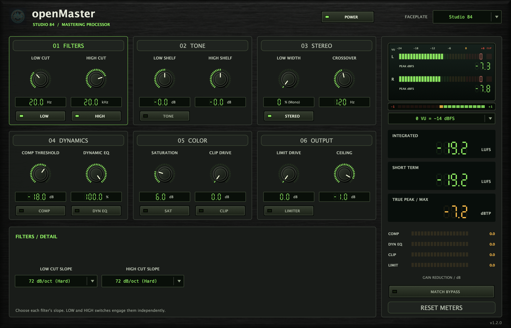

# Native UI screenshot

`assets/native-ui.png` was captured on macOS on 2026-10-27 from the actual **v1.2.0 VST3 editor**, downloaded and installed through OpenVST Manager into an isolated temporary plugin folder. The archive checksum, bundle signature and version were verified before capture. It shows the default Studio 84 faceplate while processing a stereo test signal at 48 kHz with a 120 BPM host transport.

A JUCE 8.0.9 host loads the VST3 and captures its native AppKit view at the display's backing resolution (2240 × 1440). Controls, labels, meters and version text come from the running plugin. The embedded faceplate texture is described in [the artwork record](../assets/ANALOG-CYBER.md).

- [Release v1.2.0](https://github.com/alanmarcero/openMaster/releases/tag/v1.2.0)
- [Source commit 8418d55](https://github.com/alanmarcero/openMaster/commit/8418d55d4b888958e728da3999810c9eaf7a59d5)
- Release asset: `openMaster-VST3-macOS.zip`
- Archive SHA-256: `020225768165b4a4e1ca80ac00ec77ea9b04c37e4f9cbb5a57013b01c44af6a3`
- Screenshot SHA-256: `4430914b2d52bb6fb5af1308f7b5dcbd24a99f33b1c513eb7849ee36ffff8f8f`
